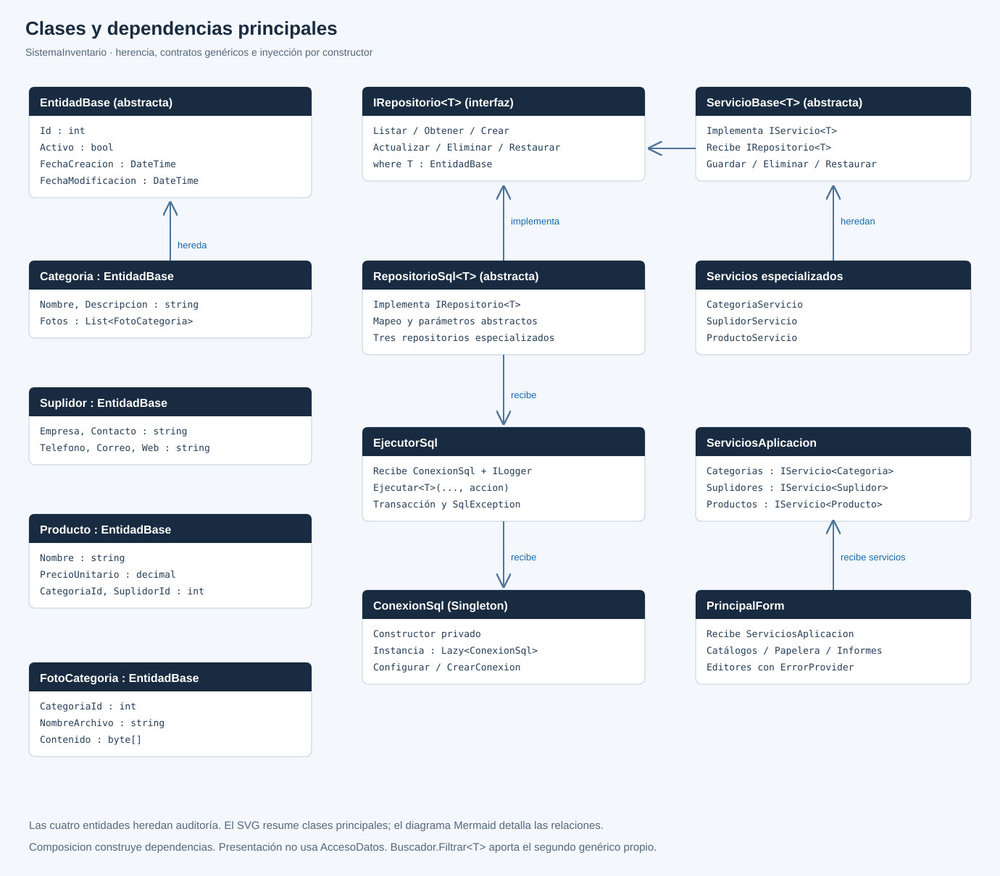
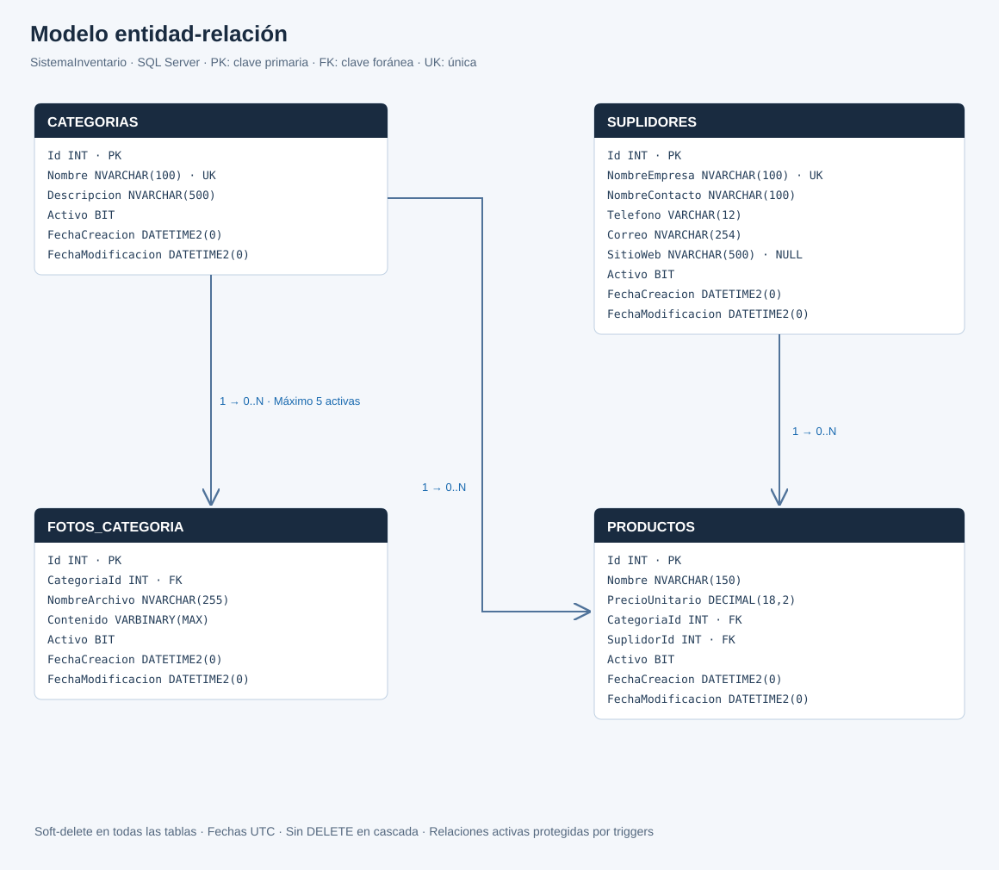

# Sistema de Inventario · ISW-124

Aplicación individual en **C# / Windows Forms / SQL Server** para categorías, suplidores y productos. Cuatro proyectos de aplicación, un proyecto adicional de pruebas y publicación **Release para Windows x64** incluida.

## Empezar en cinco pasos

1. Extraiga **todo** el ZIP. No ejecute dentro del archivo comprimido.
2. En SQL Server Management Studio, conectado a su instancia de SQL Server, ejecute `database/schema.sql` **una vez**. Después ejecute `database/datos.sql`. La muestra contiene **5 categorías, 5 suplidores y 20 productos**; no incluye fotografías.
3. Abra `build/win-x64/conexion.txt` con Bloc de notas y cambie `Server` por su instancia real. Ejemplos más abajo. La base se crea por separado; la aplicación nunca ejecuta los scripts automáticamente.
4. Instale **.NET 8 Desktop Runtime x64** en Windows, si no está instalado. No basta el runtime de ASP.NET ni el SDK sin soporte de escritorio. Descarga oficial: https://dotnet.microsoft.com/download/dotnet/8.0 (sección .NET Desktop Runtime).
5. Ejecute `ejecutar.cmd` o `build/win-x64/SistemaInventario.Presentacion.exe`. Mantenga el EXE junto a sus DLL, archivos JSON y `conexion.txt`.

## Conexión

Predeterminado para SQL Server Express con autenticación de Windows:

```text
Server=.\SQLEXPRESS;Database=SistemaInventario;Integrated Security=True;Encrypt=True;TrustServerCertificate=True;Connect Timeout=10;
```


## Abrir y compilar el código

Instale Visual Studio 2022 con **Desarrollo de escritorio de .NET** y compatibilidad con .NET 8. Abra `src/SistemaInventario.sln`, restaure NuGet y establezca **SistemaInventario.Presentacion** como proyecto de inicio. Presione F5. Los formularios están construidos por código; no requieren archivos `.Designer.cs` ni recursos generados para funcionar. Consulte `docs/Guia_Paso_a_Paso.md` para localizar cada control y evento.

Desde PowerShell, en la carpeta raíz, con el SDK .NET 8:

```powershell
.\compilar.ps1
```

Para generar una publicación que incluya el runtime y pueda ejecutarse sin instalarlo:

```powershell
.\compilar.ps1 -Autocontenido
```

La publicación incluida es **dependiente del runtime**, compilada en Release y orientada a `win-x64`. La opción autocontenida aumenta el tamaño y necesita descargar los paquetes de runtime al compilar.

## Estructura

```text
SistemaInventario/
  README.md
  compilar.ps1
  ejecutar.cmd
  src/
    SistemaInventario.sln
    SistemaInventario.Entidades/
    SistemaInventario.AccesoDatos/
    SistemaInventario.LogicaNegocio/
    SistemaInventario.Presentacion/
  database/
    schema.sql
    datos.sql
    verificar.sql
    pruebas.sql
  docs/
    Matriz_Requisitos.md
    Diagrama_Clases.svg
    Diagrama_ER.svg
    diagramas.md
    Pruebas_y_Limitaciones.md
    capturas/
  tests/SistemaInventario.Pruebas/
  build/win-x64/
```

## Funciones

- **Categorías:** alta, edición, listado, búsqueda por nombre/descripción, entre 0 y 5 fotos JPG/JPEG/PNG de máximo 2 MB cada una.
- **Suplidores:** empresa única, contacto, teléfono dominicano, correo y sitio web opcional HTTP/HTTPS.
- **Productos:** precio positivo con máximo dos decimales, categoría y suplidor activos; búsqueda por producto/categoría/suplidor, filtros combinados y rango inclusivo de precios.
- **Papelera:** búsqueda por tipo y nombre y restauración de los tres catálogos. Las fotos se conservan al eliminar y restaurar su categoría.
- **Informes LINQ:** conteo y promedio por categoría, top cinco suplidores y productos por encima del promedio global.
- **Auditoría:** fechas UTC en SQL y hora local en los listados. Todas las tablas tienen `Activo`, creación y modificación.

Para editar o eliminar, seleccione una fila. Con una lista vacía, esos botones permanecen deshabilitados. El botón **Nuevo** permite crear el primer registro. Un doble clic en la fila también abre el editor. Si falla la conexión, corrija el archivo de conexión, reinicie la aplicación y pruebe de nuevo.

## Decisiones de negocio

1. La especificación de fotos menciona “una o más”, pero fija mínimo 0: se adopta el rango explícito **0–5**.
2. Categoría: nombre 3–100 y descripción 1–500 caracteres. Empresa/contacto: 3–100; producto: 3–150. Estas últimas longitudes concretan el requisito general de nombres dentro de longitud permitida.
3. La unicidad de categoría y empresa se conserva **incluyendo eliminados**. Así no se producen conflictos al restaurar. Se ignoran mayúsculas y se conservan diferencias de acentos en SQL.
4. No se puede desactivar una categoría o suplidor con productos activos. Debe reasignar o eliminar primero los productos.
5. Para restaurar un producto, su categoría y suplidor deben estar activos. Restaure esas asociaciones primero.
6. Las fotos se guardan en `VARBINARY(MAX)`, no en rutas del equipo. Al editar la colección, las versiones anteriores quedan inactivas; la papelera principal gestiona categorías, suplidores y productos, no el historial individual de fotos.
7. Los nombres de productos pueden repetirse: la consigna solo exige que no estén vacíos. No se agrega inventario de existencias, login ni facturación porque no forman parte de esta práctica.

## Arquitectura y patrones

`Presentacion → LogicaNegocio → AccesoDatos → SQL Server`; las capas comparten contratos y modelos de `Entidades`.

- `IRepositorio<T>`: contrato genérico de CRUD; `RepositorioSql<T>` implementa lo repetido.
- `ConexionSql`: Singleton de configuración y fábrica de conexiones de corta duración. No comparte una conexión abierta entre formularios.
- Inyección por constructor en servicios y repositorios. `Composicion.Crear` construye el grafo fuera de los formularios.
- `Buscador.Filtrar<T>`: método genérico adicional.
- La referencia de Negocio hacia Datos usa `PrivateAssets="compile"`: la presentación no puede compilar llamadas a Datos, pero las dependencias de ejecución sí se publican.
- Escrituras transaccionales, SQL parametrizado, integridad referencial y triggers para relaciones activas y límite de fotos. Las escrituras de la aplicación se serializan con un bloqueo de transacción.

## Aprender el proyecto

1. Lea [Guía paso a paso](docs/Guia_Paso_a_Paso.md).
2. Abra **`docs/Codigo_Explicado.html`** en el navegador: contiene el código C#, los proyectos y los scripts SQL, numerados y con explicación por línea. Funciona sin Internet.
3. Consulte [matriz de requisitos](docs/Matriz_Requisitos.md) y [diagramas](docs/diagramas.md).
4. Ejecute pruebas y ensaye la demostración descrita en la guía.

## Pruebas y errores

```powershell
dotnet run --project tests/SistemaInventario.Pruebas -c Release
```

Las 82 pruebas usan repositorios en memoria para aislar reglas de negocio; no prueban SQL Server ni Windows Forms. En SSMS ejecute `database/verificar.sql` para integridad y, en una base de prueba recién inicializada, `database/pruebas.sql` para nueve pruebas de rechazo con rollback.

Los errores técnicos se escriben en:

```text
%LOCALAPPDATA%\SistemaInventario\errores.log
```

[Resultados, límites y lista manual](docs/Pruebas_y_Limitaciones.md).

## Capturas reales

**Pendientes de generar en Windows.** El proyecto incluye [instrucciones y un capturador](docs/capturas/README.md) para guardar fotografías reales de cada formulario. Ejecute `docs/capturas/capturar.ps1` y siga sus mensajes. Una vez creados los PNG, puede añadirlos al README con las rutas `docs/capturas/01-productos.png`, `02-categorias.png`, `03-suplidores.png`, `04-papelera.png` y `05-informes.png`.

Diagramas incluidos (documentación, no capturas de la interfaz):





```powershell
git init
git add .
git commit -m "Implementa sistema de inventario ISW-124"
git branch -M main
git remote add origin https://github.com/TU-USUARIO/SistemaInventario.git
git push -u origin main
```

## Referencias técnicas oficiales

- Publicación: https://learn.microsoft.com/dotnet/core/tools/dotnet-publish
- Windows Forms: https://learn.microsoft.com/dotnet/desktop/winforms/overview/
- Microsoft.Data.SqlClient: https://www.nuget.org/packages/Microsoft.Data.SqlClient/6.1.7
- Triggers T-SQL: https://learn.microsoft.com/sql/t-sql/statements/create-trigger-transact-sql
- Bloqueos: https://learn.microsoft.com/sql/relational-databases/sql-server-transaction-locking-and-row-versioning-guide
