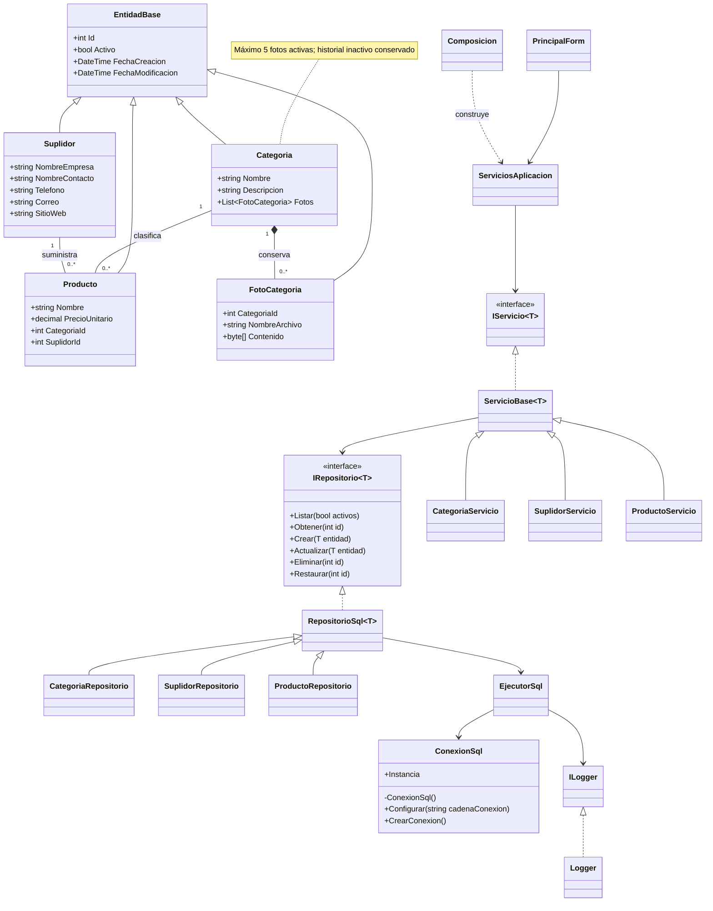
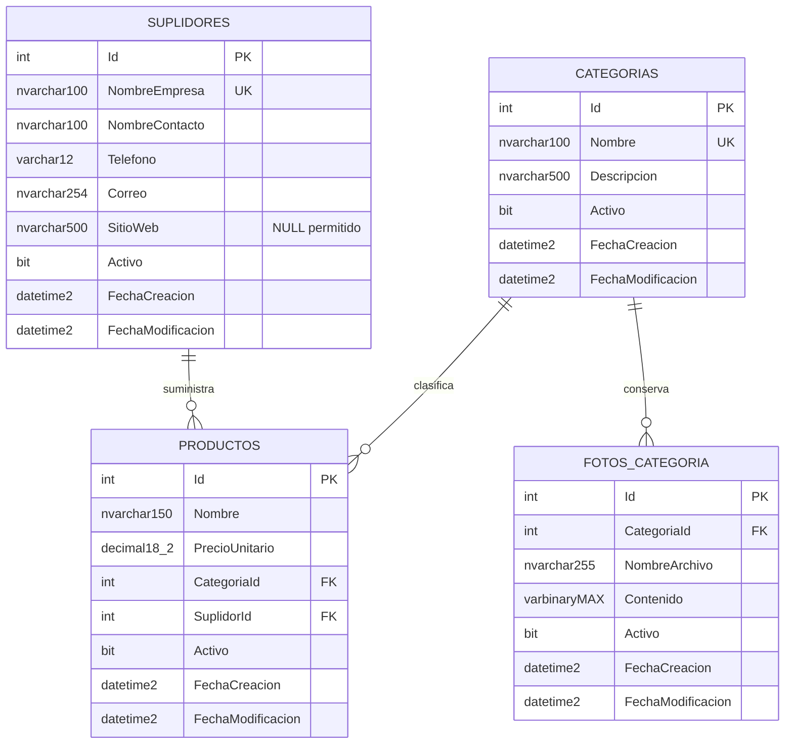

# Diagramas

Los SVG incluidos se pueden abrir directamente en el navegador. Estas fuentes Mermaid se renderizan en GitHub.

## Clases principales

## Modelo entidad-relación

El máximo de cinco fotos aplica a las filas activas. La cardinalidad física es 0..N porque las versiones anteriores de fotografías se conservan inactivas. Cada fotografía tiene un único padre.

Los nombres de categoría y empresa son únicos en toda la tabla, incluso en la papelera. Las FK no utilizan borrado en cascada. Los triggers controlan el estado activo de asociaciones y el máximo de fotos. Las fechas se almacenan en UTC.
